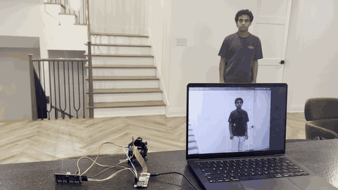
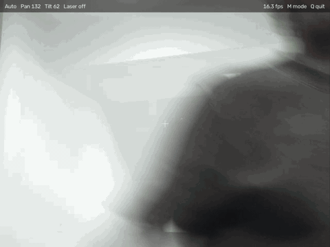
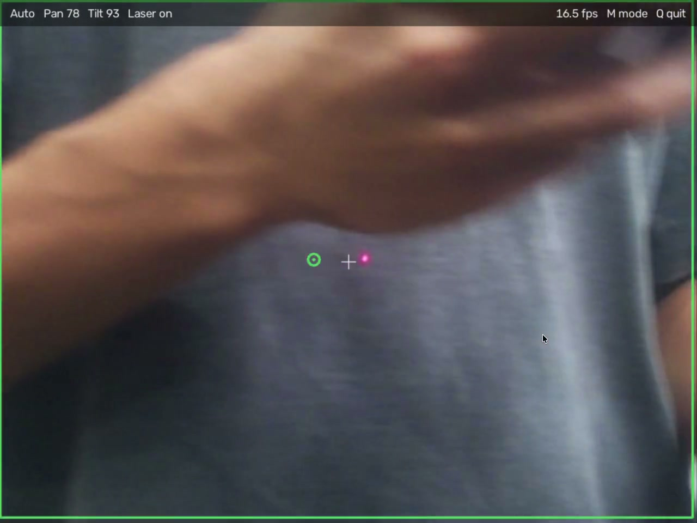
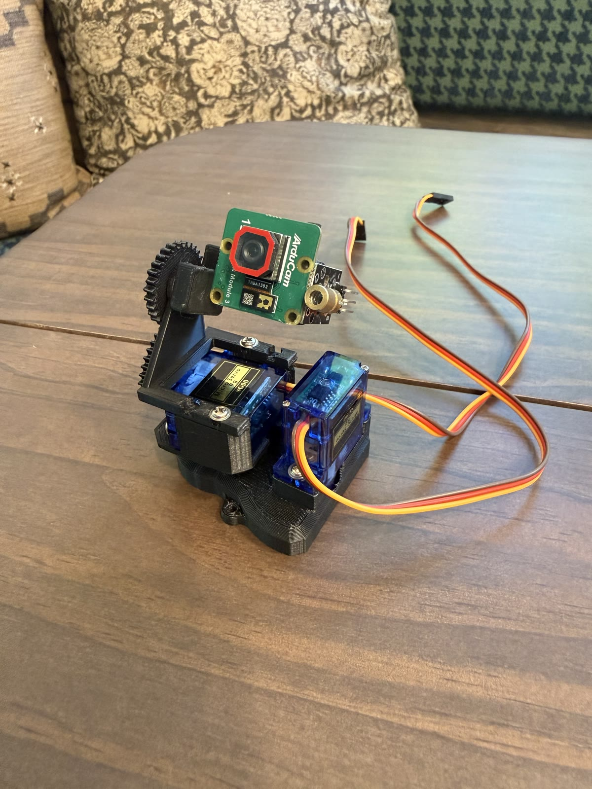
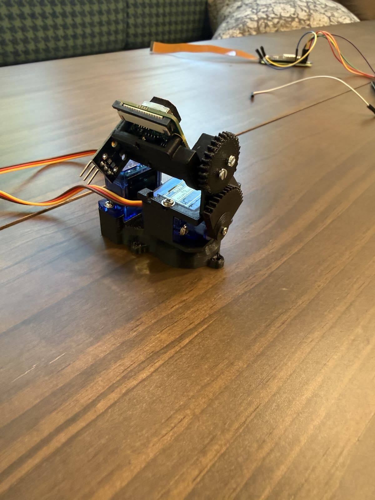
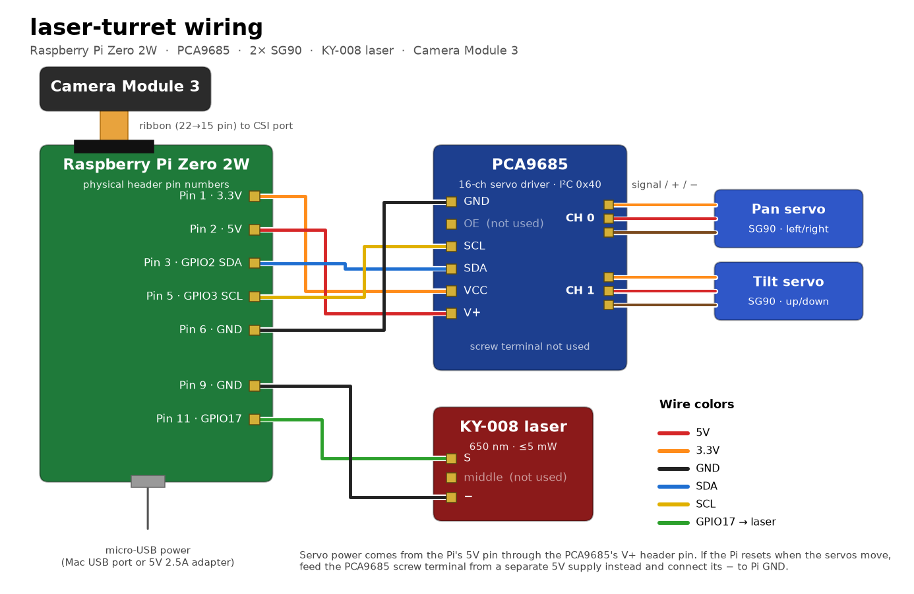

# laser-turret

A pan/tilt turret that finds people with YOLO and tracks them with a laser dot in real time.
A Raspberry Pi Zero 2W streams its camera to a Mac. The Mac runs person detection and sends servo and laser commands back, at about 15–19 fps.



**3D-printed parts:** [Printables](https://www.printables.com/model/1731488-person-tracking-laser-turret-raspberry-pi-python)

| What the turret sees | Laser on target |
|---|---|
|  |  |

> [!WARNING]
> **Laser safety.** Use a low-power (≤5 mW, Class 2/3R) module like the KY-008, and never look into the beam. The turret aims at the middle of the detected body, but a bad detection, a crouching person or a pet can put the beam near someone's eyes. Only run it around people who know it's on, and never point it at aircraft, vehicles or animals.

---

## How it works

```
Raspberry Pi Zero 2W                    Mac
────────────────────────                ─────────────────────────────
Camera Module 3                         main.py (TCP server)
  → capture 640×480 frame                 → decode JPEG
  → rotate 180°, JPEG encode              → YOLO11n person detection
  → send over TCP          ──────────►    → error from frame center
                                          → gain + dead zone + EMA smoothing
  → set pan/tilt servos    ◄──────────    → send {"pan","tilt","laser"} JSON
  → laser on/off (GPIO 17)                → draw the HUD window
```

- **Detection:** YOLO11n (nano), person class only, on the Mac CPU. No GPU needed.
- **Aim point:** center of the first detected person's box, shifted left 30 px to make up for the gap between camera and laser.
- **Control:** proportional step toward the aim point, ignored inside a 40 px dead zone, smoothed with an EMA so the servos don't jitter.
- **Laser:** on while a person is tracked in auto mode, off otherwise.
- **Link:** plain TCP on port 9999. Same Wi-Fi works; [Tailscale](https://tailscale.com) works across networks.

---

## Hardware

The mechanics are a remix of **Cheap FPV Gimbal – Pan/Tilt by Steve Eckerlein** on Printables. His base, servo mounts and gears are used unchanged; this project adds a new top part and a mount that carries the Pi camera and laser. Full credit to him for the gimbal.

| Camera and laser on the tilt axis | Gears and servos |
|---|---|
|  |  |

Full parts list (about $112): [`hardware/BOM.md`](hardware/BOM.md) · Wiring details: [`hardware/wiring.md`](hardware/wiring.md) · Printable parts: [`hardware/stl/`](hardware/stl/)

| Part | Notes |
|---|---|
| Raspberry Pi Zero 2W | Camera, servos, laser |
| Camera Module 3 (IMX708) | CSI ribbon, mounted on the tilt axis |
| PCA9685 16-channel servo driver | I²C address `0x40`, 50 Hz |
| 2× SG90 micro servos | Pan on channel 0, tilt on channel 1 |
| KY-008 laser module | Signal on GPIO 17 |
| Mac | Runs detection and the HUD |



---

## Repository layout

```
laser-turret/
├── turret-mac/              # runs on the Mac
│   ├── main.py              # TCP server, tracking loop, keyboard controls
│   ├── detector.py          # YOLO11n person detection and aim point
│   ├── hud.py               # on-screen overlay (boxes, aim point, status bar)
│   ├── camera.py            # webcam helper for local experiments (not used by main.py)
│   └── requirements.txt
├── turret-pi/               # runs on the Raspberry Pi
│   ├── pi_main.py           # camera capture, servos, laser
│   └── requirements.txt
├── hardware/
│   ├── BOM.md               # bill of materials
│   ├── wiring.md            # pin-by-pin wiring
│   ├── wiring.png / .svg    # wiring diagram
│   ├── make_wiring_diagram.py
│   └── stl/                 # new printed parts for this remix
├── media/                   # GIF and photos used in this README
├── docs/
│   ├── printables.md        # text for the Printables listing
│   └── publishing.md        # what gets uploaded where
└── README.md
```

---

## Setup

### Mac

Python 3.10 or newer.

```bash
git clone https://github.com/olivergollapudi/laser-turret.git
cd laser-turret/turret-mac
python3 -m venv venv
source venv/bin/activate
pip install -r requirements.txt
```

The YOLO weights (`yolo11n.pt`, about 5 MB) download automatically the first time you run it.

### Raspberry Pi

Flash Raspberry Pi OS (Bookworm), then enable I²C and the camera with `sudo raspi-config` → Interface Options.

```bash
sudo apt update
sudo apt install -y python3-pip python3-opencv python3-picamera2 i2c-tools
python3 -m venv --system-site-packages ~/turret-venv
source ~/turret-venv/bin/activate
pip install adafruit-circuitpython-servokit adafruit-circuitpython-pca9685 RPi.GPIO
```

Copy the Pi code over from your Mac:

```bash
scp -r turret-pi <user>@<pi-ip>:~/
```

Check the hardware:

- `sudo i2cdetect -y 1` should show `40` (the PCA9685)
- `rpicam-hello --timeout 3000` (or `libcamera-hello` on older images) should show the camera

### Network

The Pi connects to the Mac, so the Pi needs the Mac's IP. Set it when you start the Pi script:

```bash
TURRET_MAC_IP=192.168.1.52 python3 ~/turret-pi/pi_main.py
```

Or change the default `MAC_IP` at the top of `turret-pi/pi_main.py`. If the devices aren't on the same network, install Tailscale on both and use the Mac's `100.x.x.x` address.

---

## Running

**1. Start the Mac side first**

```bash
cd turret-mac
source venv/bin/activate
python3 main.py
```

It prints `Waiting for Pi to connect on port 9999...`

**2. Start the Pi side**

```bash
source ~/turret-venv/bin/activate
TURRET_MAC_IP=<mac-ip> python3 ~/turret-pi/pi_main.py
```

A window opens on the Mac with the live feed: a green box on the tracked person, a green circle at the aim point, a white crosshair at the frame center, and a status bar with mode, pan/tilt angles, laser state and fps.

| Key | Action |
|---|---|
| `M` | Switch between auto tracking and manual |
| Arrow keys | Move the turret (manual mode) |
| `Q` | Quit |

---

## Tuning

In `turret-mac/main.py`:

| Setting | Current | What it does |
|---|---|---|
| `PAN_GAIN` / `TILT_GAIN` | `0.065` | Degrees moved per pixel of error. Higher is faster but overshoots. |
| `DEADZONE` | `40` px | Errors smaller than this are ignored, so it holds still once on target. |
| `SMOOTH` | `0.4` | EMA factor. Lower is smoother but slower. |
| `PAN_MIN/MAX`, `TILT_MIN/MAX` | `30–150`, `60–120` | Servo limits. Set these to what your mount can physically reach (and match them in `pi_main.py`). |

In `turret-mac/detector.py`, `get_centroid()` holds the camera-to-laser offset:

```python
cx = x + w // 2 - 30   # change -30 if the dot lands left or right of the aim circle
```

Other notes:

- `pi_main.py` rotates frames 180° because the camera is mounted upside down. Remove the `cv2.ROTATE_180` line if yours isn't.
- The Pi sends RGB frames, and `main.py` swaps them to BGR. If people look blue, remove that `cvtColor` line.
- JPEG quality is 70. Lower it for a faster link, raise it for better detection.

---

## License

Code: MIT, see [LICENSE](LICENSE). 3D models: CC BY-NC-SA 4.0, see the [Printables page](https://www.printables.com/model/1731488-person-tracking-laser-turret-raspberry-pi-python). The gimbal parts are Steve Eckerlein's design under CC BY-NC.
