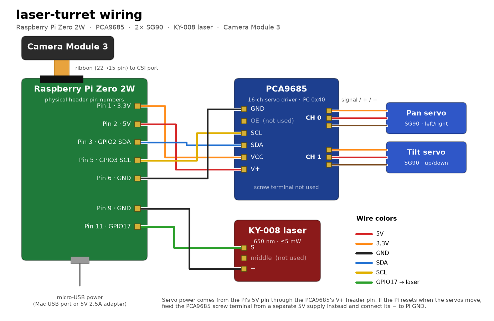

# Wiring

Pin numbers are physical header pins on the Pi Zero 2W. ([SVG version](wiring.svg) · regenerate with `python hardware/make_wiring_diagram.py hardware/wiring`)

## Pi → PCA9685 servo driver

Six jumper wires to the PCA9685's header pins. The screw terminal isn't used.

| PCA9685 pin | Pi pin |
|---|---|
| GND | Pin 6 · GND |
| OE | not connected |
| SCL | Pin 5 · GPIO3 (SCL) |
| SDA | Pin 3 · GPIO2 (SDA) |
| VCC | Pin 1 · 3.3V (logic power) |
| V+ | Pin 2 · 5V (servo power) |

## PCA9685 → servos

| Channel | Servo | Moves |
|---|---|---|
| CH 0 | Pan | left / right |
| CH 1 | Tilt | up / down |

Plug each SG90 in with the orange (signal) wire toward the PWM row and brown (−) toward GND.

## Pi → KY-008 laser

| KY-008 pin | Pi pin |
|---|---|
| S | Pin 11 · GPIO17 |
| middle | not connected |
| − | Pin 9 · GND |

The laser is switched straight from GPIO17, not through the PCA9685.

## Camera

Camera Module 3 to the Pi Zero's CSI port with a 22-to-15-pin ribbon. The camera sits upside down on the turret, so `pi_main.py` rotates each frame 180°.

## Power

The Pi is powered over micro-USB (from the Mac or a 5V 2.5A adapter), and the servos draw from the Pi's 5V pin through V+. That's enough for two SG90s. If the Pi reboots or the camera feed drops when the servos move, power the PCA9685's screw terminal from a separate 5V supply instead, disconnect the V+ jumper, and connect the supply's − to Pi GND.
